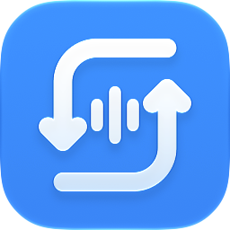

# Soniclet



macOSの入出力デバイスをメニューバーから切り替える、小さなネイティブアプリです。[English](README.md)

- 入力・出力デバイスの切替と出力音量の調整
- 設定のチェックで、使わない機器をこのアプリの一覧から非表示に
- メニューバーの右クリックから現在の機器確認・消音・設定・終了
- 設定のアイコン付きドロップダウンで、標準スピーカー／Sonicletのマークを選択。初期選択はシステムアイコンで、見本は両方とも音量2段階です。マークは音量に応じて中央の波形が左から点灯し、消音時は3本とも半透明になります
- macOS標準のログイン時起動設定
- システムの言語設定に従う34言語の表示
- GitHub Releasesの新しい安定版をメニューでお知らせ

音声の録音・加工やドライバーの導入は行いません。機器の非表示は、このアプリの一覧にだけ適用されます。

## ビルド

動作対象はmacOS 14以降。ビルドにはSwift 6.4・macOS 27 SDKとIcon Composer用のアセットコンパイラを含むXcode 27が必要です。外部パッケージは不要です。

```sh
./build.sh
./test.sh
open 'Soniclet.app'
```

Apple SiliconとIntel両方の実行形式を作る場合は、`ARCHS='arm64 x86_64' ./build.sh`を使います。Intel実機での動作確認は別途必要です。

生成アプリはローカル検証用のアドホック署名です。Developer ID署名・Appleの公証はまだ行っていません。

旧Sound Switchの表示設定は、Sonicletの設定がまだない場合に限り引き継ぎます。ログイン時起動はSonicletの設定で管理します。

## 制限

AirPlay機器には、先に「システムのサウンド設定…」で接続してください。未接続のHomePodなどを、このアプリから直接検出・接続する機能はありません。

音量調整や消音は機器の対応状況に依存します。アプリ側で独自に出力先を指定している場合、システムの既定デバイス変更が反映されないことがあります。

翻訳には文字列・書式の自動チェックがありますが、全言語について母語話者による確認を終えてはいません。修正を歓迎します。

## 開発と公開準備

[開発方針](AGENTS.md)、[リリース手順](docs/RELEASING.md)を参照してください。設定画面やメニューバーの変更後は、ログイン済みのmacOS環境で`./test-settings.sh`も実行します。

メニューの開閉・配置・外側クリック・Escapeによる閉じる操作は、AppKitのNSMenuに任せています。内容はNSMenuItem.view上のSwiftUIです。NSPopoverは使っていません。

## ヘッドフォンとバッテリー

システムアイコンの選択中は、ヘッドフォン出力に合わせて標準のヘッドフォン記号を使います。Sonicletのマークを選んだ場合は、その選択を保ちます。

残量はmacOS標準の`system_profiler`が返す、接続中のBluetooth機器情報から読み取ります。同じ接続では最短1分間隔で、メインスレッド外から取得します。生のレポートは保存・送信しません。

取得できた残量だけを表示します。左右別のイヤホンでは取得できた左右の低い方を使い、ケースの残量をイヤホンの残量として表示することはありません。WH-1000XM3のように、Appleのメニューでは表示されてもこの標準レポートに残量が出ない機器では、空欄になります。

Appleのヘッドフォン接続中は、対応するOS設定パネルへの導線を表示します。その他のBluetoothオーディオ機器や古いmacOSではBluetooth設定へ移動します。ノイズコントロール・空間オーディオ・会話感知はシステム設定に任せます。

## 更新確認とプライバシー

起動時とメニューを開いた時に、1日1回までGitHub Releasesを確認します。手動確認もできます。新しい安定版がある場合はメニューに表示し、クリックすると該当するリリースページを開きます。自動ダウンロードやインストールは行いません。

GitHubへアプリのバージョンを含む通常のHTTPSリクエストを送りますが、デバイス名・音声・音量設定は送りません。自動確認の通信エラーは通知せず、手動確認では結果を表示します。

Icon Composerの原稿と旧macOS向けアイコンを同梱しています。Developer ID署名用のビルド設定と公証スクリプトも用意していますが、Apple Developer Program加入・証明書の準備・実際の公証はまだ完了していません。

ライセンスは[MIT](LICENSE)です。
